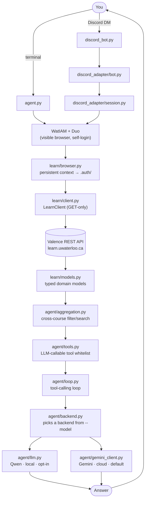

# LEARN Agent

Ask your D2L/Brightspace account a question, get a real answer — from a
terminal or a Discord DM.

You log into WatIAM + Duo yourself, in a real, visible browser. This app
never sees your credentials. From there, an LLM answers questions about
your courses, assignments, grades, quizzes, and announcements by calling a
small set of **read-only** tools against Brightspace's documented API.
Nothing here can click, submit, or change anything — every call is a `GET`.

By default, questions and LEARN data go to Google's Gemini API
(`--model qwen` keeps everything local via Ollama instead — see
[Quick start](#quick-start)).

Curious how it actually works, what broke during live testing, or what's
left to build? → [HANDOFF.md](HANDOFF.md)

---

## Architecture

Click any box to jump to the file that implements it.



Full hop-by-hop breakdown (with the "why" behind each box) in
[HANDOFF.md's architecture diagram](HANDOFF.md#full-architecture-diagram).

---

## Quick start

```bash
git clone <this repo>
cd <this repo>
python3 -m venv .venv && source .venv/bin/activate
pip install -r requirements.txt
playwright install chromium
```

```bash
python agent.py                 # chat in your terminal
python discord_bot.py           # chat over Discord DM instead
```

| Flag / command | Does what |
|---|---|
| `--model qwen` | Local Ollama (`qwen3:8b`), nothing leaves your machine |
| `--model gemini` (default) | Google's Gemini API — needs `GEMINI_API_KEY` in `.env` |
| `--debug` | Print tool calls to your terminal, never to Discord |
| `python agent.py logout` | Wipe the saved LEARN session |
| `python agent.py --test-llm` | Check LLM connectivity only, no browser |

`.env.example` has the full list of optional config (`GEMINI_API_KEY`,
`DISCORD_BOT_TOKEN` + `DISCORD_ALLOWED_USER_ID`, optional WatIAM auto-fill).

---

## Layout

```
agent.py             CLI entry point
discord_bot.py        Discord DM entry point
learn/                 auth + Brightspace API client, normalized into typed models
agent/                  LLM tool layer + the tool-calling loop (Qwen or Gemini)
discord_adapter/         Discord transport — DM gating, rate limiting, chunking
tests/                    177 tests, fully offline
```

---

## Security, in short

- **No credentials, by default.** You complete WatIAM + Duo yourself; this
  code only watches the URL and DOM, never fills the login form.
- **Session, not password, on disk.** `.auth/browser-profile/` holds live
  cookies, gitignored, wiped with `python agent.py logout`.
- **The LLM sees your data, never your session.** Only chat + tool results
  (HTML-stripped, `raw` fields dropped) reach the model — never cookies,
  never Playwright, never `.env`.
- **Gemini is the default backend** — your prompts and LEARN data go to
  Google unless you pass `--model qwen`, which keeps everything local.
- **Discord bot replies to exactly one user ID.** Everyone else gets
  silence, not an error.
- **Zero write capability**, anywhere, for either backend.

Design rationale behind these choices is in [HANDOFF.md](HANDOFF.md).

---

## Testing

```bash
python -m pytest
```

Fully offline — no live LEARN login, no LLM server, no network calls.
Details in [HANDOFF.md](HANDOFF.md#testing-in-depth).
