# LEARN Agent

Ask your D2L/Brightspace account a question, get a real answer — from a
terminal or a Discord DM.

You log into WatIAM + Duo yourself, in a dedicated Chrome/Edge window. This
app never sees your credentials; it keeps only the handful of LEARN session
cookies it needs, then talks to LEARN over plain HTTPS. From there, an LLM answers questions about
your courses, assignments, grades, quizzes, and announcements by calling a
small set of **read-only** tools against Brightspace's documented API.
Nothing here can click, submit, or change anything — every call is a `GET`.

By default, questions and LEARN data go to Google's Gemini API
(`--model qwen` keeps everything local via Ollama instead — see
[Quick start](#quick-start)).

Curious how it actually works, what broke during live testing, or what's
left to build? → [HANDOFF.md](HANDOFF.md)

---

## Architecture

Click any box to jump to the file that implements it.

```mermaid
flowchart TD
    U([You]) -->|terminal| A[agent.py]
    U -->|Discord DM| DB[discord_bot.py]
    DB --> DA["discord_adapter/bot.py"]
    DA --> DS["discord_adapter/session.py"]

    A --> AUTH["WatIAM + Duo<br/>(dedicated Chrome, self-login)"]
    DS --> AUTH
    AUTH --> BR["learn/cdp.py + session.py<br/>CDP sign-in → stored session"]
    BR --> TR["learn/transport.py<br/>requests + cookies"]
    TR --> LC["learn/client.py<br/>LearnClient (GET-only)"]
    LC --> VAPI[("Valence REST API<br/>learn.uwaterloo.ca")]
    VAPI --> MODELS["learn/models.py<br/>typed domain models"]
    MODELS --> AGG["agent/aggregation.py<br/>cross-course filter/search"]
    AGG --> TOOLS["agent/tools.py<br/>LLM-callable tool whitelist"]
    TOOLS --> LOOP["agent/loop.py<br/>tool-calling loop"]
    LOOP --> BACKEND["agent/backend.py<br/>picks a backend from --model"]
    BACKEND --> QWEN["agent/llm.py<br/>Qwen · local · opt-in"]
    BACKEND --> GEMINI["agent/gemini_client.py<br/>Gemini · cloud · default"]
    QWEN --> ANS([Answer])
    GEMINI --> ANS
    ANS --> U

    click A "https://github.com/jaedonvisva/plnr/blob/main/agent.py" "CLI entry point" _blank
    click DB "https://github.com/jaedonvisva/plnr/blob/main/discord_bot.py" "Discord DM entry point" _blank
    click DA "https://github.com/jaedonvisva/plnr/blob/main/discord_adapter/bot.py" "Message handling, auth/DM gating, chunking" _blank
    click DS "https://github.com/jaedonvisva/plnr/blob/main/discord_adapter/session.py" "Owns the agent loop per Discord session" _blank
    click AUTH "https://github.com/jaedonvisva/plnr/blob/main/learn/auth.py" "Sign-in orchestration + whoami verification" _blank
    click BR "https://github.com/jaedonvisva/plnr/blob/main/learn/cdp.py" "Dedicated-browser CDP sign-in, origin-gated" _blank
    click TR "https://github.com/jaedonvisva/plnr/blob/main/learn/transport.py" "Cookie-replay HTTP transport, expiry detection, retries" _blank
    click LC "https://github.com/jaedonvisva/plnr/blob/main/learn/client.py" "LearnClient: Valence HTTP calls, typed errors" _blank
    click MODELS "https://github.com/jaedonvisva/plnr/blob/main/learn/models.py" "Course/Assignment/Grade/Quiz/Announcement dataclasses" _blank
    click AGG "https://github.com/jaedonvisva/plnr/blob/main/agent/aggregation.py" "Deterministic date filtering, search, sorting" _blank
    click TOOLS "https://github.com/jaedonvisva/plnr/blob/main/agent/tools.py" "The only thing the LLM can call" _blank
    click LOOP "https://github.com/jaedonvisva/plnr/blob/main/agent/loop.py" "Tool-calling loop, up to 20 rounds" _blank
    click BACKEND "https://github.com/jaedonvisva/plnr/blob/main/agent/backend.py" "Resolves --model to a concrete backend" _blank
    click QWEN "https://github.com/jaedonvisva/plnr/blob/main/agent/llm.py" "Local Ollama client config" _blank
    click GEMINI "https://github.com/jaedonvisva/plnr/blob/main/agent/gemini_client.py" "The one cloud-API module, strictly opt-in" _blank
```



Full hop-by-hop breakdown (with the "why" behind each box) in
[HANDOFF.md's architecture diagram](HANDOFF.md#full-architecture-diagram).

---

## Quick start

```bash
git clone <this repo>
cd <this repo>
python3 -m venv .venv && source .venv/bin/activate
pip install -r requirements.txt
```

```bash
python agent.py auth            # one-time sign-in (needs Chrome or Edge)
python agent.py                 # chat in your terminal
python discord_bot.py           # chat over Discord DM instead
```

| Flag / command | Does what |
|---|---|
| `--model qwen` | Local Ollama (`qwen3:8b`), nothing leaves your machine |
| `--model gemini` (default) | Google's Gemini API — needs `GEMINI_API_KEY` in `.env` |
| `--debug` | Print tool calls to your terminal, never to Discord |
| `python agent.py auth` | Sign in via a dedicated Chrome/Edge window, save the session |
| `python agent.py auth --check` | Verify the saved session, no browser (exit 75 if expired) |
| `python agent.py auth --paste` | Sign in by pasting cookies (hidden input) — no browser/display needed |
| `python agent.py auth --clear-profile` | Remove saved session + browser profile (resets Duo trust) |
| `python agent.py logout` | Forget the saved session (keeps Duo trust) |
| `python agent.py today [--days N] [--ics FILE]` | What's due (past due, today, coming up) with no LLM; optional `.ics` calendar export |
| `python agent.py diff [--no-save]` | What changed in LEARN since the last check: new/removed items, moved due dates, edited announcements, grade changes |
| `python agent.py doctor` | Diagnose setup problems and print one next step |
| `python agent.py --test-llm` | Check LLM connectivity only, no browser |

**Optional: announcement triage.** `pip install -r requirements-triage.txt`
adds a local decision model ([Laya](https://huggingface.co/convaiinnovations/laya),
torch + ~800 MB of weights) and one extra tool, `get_important_announcements`,
so "anything I need to act on?" returns a short ranked list instead of every
announcement. Scores are estimates, not LEARN facts. Run
`python scripts/eval_triage.py` on your own labeled announcements to check
accuracy before trusting a threshold (the bundled fixture is synthetic).

`.env.example` has the full list of optional config (`GEMINI_API_KEY`,
`DISCORD_BOT_TOKEN` + `DISCORD_ALLOWED_USER_ID`).

---

## Always-on mode

`python discord_bot.py` doesn't only answer questions: it also watches LEARN and messages you first.
Detection is plain Python (no model decides what to send); times are Waterloo local.

| When | What you get |
|---|---|
| 8:00 | Digest: past due, today, tomorrow, this week |
| 18:00 and 22:30 | "Due tonight" and "Last call" for items due late evening (most deadlines are 11:59 PM). Items due before noon are announced the evening before |
| Any daytime poll (every 15 min) | New or edited announcements, posted grades, new items, moved due dates, batched into one message |
| 23:30-08:00 | Silence. Reminders wait (and are dropped if the deadline passes); changes arrive at the next daytime poll |

Reply to a ping with `done 2` (or `done`, `done all`) when something is handed in: LEARN doesn't tell us
whether you submitted, so this is how reminders stop. Also: `undo`, `mute 2h`, `stop tonight`, `unmute`, `!digest`.
Anything else is a normal question; the chat agent sees the ping as context.

**Reminders.** Just say it in chat: "remind me tomorrow at 9 to email my TA", "ping me in an hour", "remind me
the day before A4 is due to proofread". The model works out the time from the conversation; the system then
replies with a computed confirmation (`Reminder #3 set for Sun Oct 11, 9:00 AM (tomorrow): email my TA`) so a
wrong date is visible. They arrive at the exact time (even in quiet hours; `mute` still holds them), also while
your LEARN session is expired. `reminders` lists them, `cancel 3` removes one. No recurring reminders.
`scripts/eval_reminders.py` checks the model's date handling against the live API.

If the LEARN session expires you get one DM; run `python agent.py auth` and it resumes by itself. The bot
never opens a browser on its own.

Run it at login with launchd (macOS):

```bash
python agent.py install-service --load     # logs: .plnr/logs/
python agent.py uninstall-service
```

State lives in `.plnr/` (`ledger.json`, `proactive_snapshot.json`): ids, course labels and item names only.
Code: `agent/watchers.py` (what to say), `agent/proactive.py` (the loop), `agent/replies.py`, `agent/ledger.py`.

## Layout

```
agent.py             CLI entry point
discord_bot.py        Discord DM entry point
learn/                 auth + Brightspace API client, normalized into typed models
agent/                  LLM tool layer + the tool-calling loop (Qwen or Gemini)
discord_adapter/         Discord transport — DM gating, rate limiting, chunking
tests/                    300+ tests, fully offline
scripts/                   eval_triage.py — measure triage accuracy (manual)
```

---

## Security, in short

Login flow adapted from [agent2learn](https://github.com/ManagementMO/agent2learn) (Apache-2.0).


- **No credentials, ever.** You complete WatIAM + Duo yourself; this code
  never reads or fills the login form. During sign-in the dedicated browser is
  gated to LEARN, Duo and Waterloo's ADFS — any other host stops the flow.
- **Minimal session on disk.** Only five whitelisted LEARN cookies + the CSRF
  token are kept (OS keyring if the optional `keyring` package is installed,
  else `.auth/session.json`, mode 0600). The dedicated browser profile in
  `.auth/chrome-profile/` holds Duo's remembered-device state. Both are
  gitignored; `python agent.py auth --clear-profile` wipes them.
- **The LLM sees your data, never your session.** Only chat + tool results
  (HTML-stripped, `raw` fields dropped) reach the model — never cookies,
  never the browser, never `.env`.
- **Gemini is the default backend** — your prompts and LEARN data go to
  Google unless you pass `--model qwen`, which keeps everything local.
- **Discord bot replies to exactly one user ID.** Everyone else gets
  silence, not an error.
- **Triage stays local.** If installed, announcement scoring runs on your
  machine even under `--model gemini`; only the filtered results reach the
  chat model, like every other tool.
- **Zero write capability**, anywhere, for either backend.

Design rationale behind these choices is in [HANDOFF.md](HANDOFF.md).

---

## Testing

```bash
python -m pytest
```

Fully offline — no live LEARN login, no LLM server, no network calls.
Details in [HANDOFF.md](HANDOFF.md#testing-in-depth).
